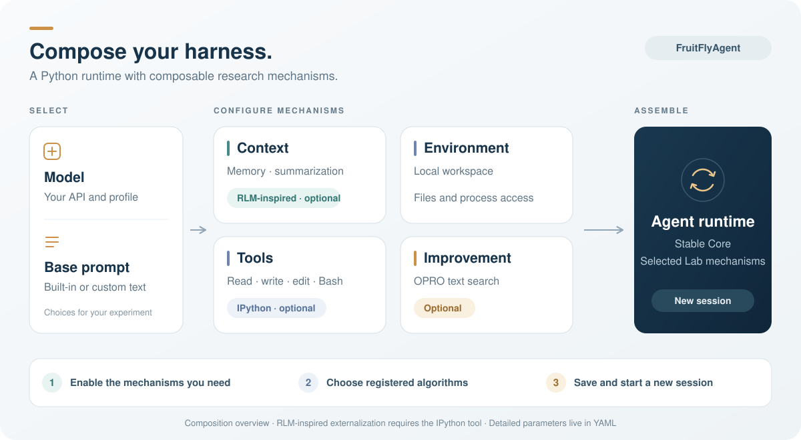
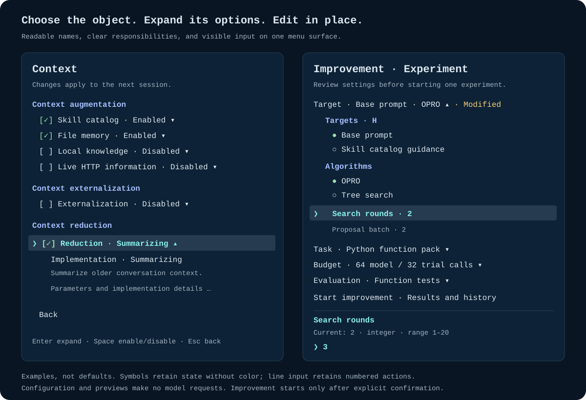

<p align="center">
  
</p>
<p align="center">
  
  
  <a href="LICENSE"></a>
</p>

# FruitFlyAgent

[Quickstart](#quickstart) · [Configuration](CONFIGURATION.md) · [Architecture](fruitfly_agent/README.md) · [RSI](fruitfly_agent/lab/rsi/README.md) · [Contributing](CONTRIBUTING.md)

**A lightweight Python agent harness for research into improvement and recursive self-improvement.**

Agent research needs a system you can understand, change, and test. FruitFlyAgent keeps the essential runtime in a small Python core, with replaceable algorithms in a pluggable Lab. Small, focused source files make mechanisms easy to inspect and modify, for both developers and coding agents.

Its Python runtime is adapted from [Pi](https://github.com/earendil-works/pi). [RLM-inspired programmatic context externalization](fruitfly_agent/lab/context_manager/externalization/programmatic_context/README.md) is one optional, pluggable Lab mechanism that you can enable for an experiment.

The research object is the **whole harness**: context, tools, execution, improvement, and adoption. Python and public extension contracts let you study these mechanisms in the same language as your experiments.

Named after **Thomas Hunt Morgan's fruit-fly research**, FruitFlyAgent uses simple systems to understand agent mechanisms. Our philosophy is **simple systems, controlled changes, rapid validation, repeatable observation, and respect for anomalous evidence**:

- Inspect before changing; take small, clear, reversible steps.
- Test a specific hypothesis against a baseline; change one factor at a time.
- Prefer quick, inexpensive checks; repeat important findings and keep them reproducible.
- Investigate failures and anomalies; revise explanations when evidence disagrees.
- Separate observations from hypotheses. Verify outcomes and report evidence, limits, and uncertainty.

Our ambition is **recursive self-improvement (RSI)**: agents that improve their own harness and improvement process through independently verified changes. FruitFlyAgent separates generation, evaluation, verification, and adoption so each step can be studied and tested.

## Built for harness research

| Design choice | Why it matters |
|---|---|
| Stable Core, pluggable Lab, explicit Catalog assembly | Replace tools, context strategies, execution backends, or search algorithms through public contracts; keep the change identifiable. |
| Target-owned trial adapters and injected search services | Separate what changes from how candidates are generated and evaluated; supply model roles, evaluators, and budgets explicitly. |
| Frozen search inputs, candidate journals, and runtime manifests | Bind comparisons to a baseline, tasks, policy, and execution identity; retain observations; ordinary recovery continues history with current configuration and records environment changes. |
| Separate proposal, verification, and adoption | Search results do not grant activation authority. Verification binds the candidate and policy before adoption. |
| Version-bound task and improver implementations | The RSI driver resolves the improver again after adoption, so the next generation can use an improved improvement process. |
| Explicit lifecycle and durable evolution phases | Own resource startup and cleanup; reconcile interrupted activation and avoid blindly replaying work with unknown cost. |

**Improvement and RSI serve different roles:**

| Capability | Role |
|---|---|
| [Improvement](fruitfly_agent/lab/improvement/README.md) | Search and compare candidates for a fixed target under a defined objective. It can run independently. |
| [RSI](fruitfly_agent/lab/rsi/README.md) | Verify and adopt changes to the system or its improver, then continue with the adopted implementation across generations. |

The `/improvement` menu selects task materials, editable components, a candidate generator, exploration and budgets. Public protocols separate proposal, execution, composition, output selection, verification and reflection. Current-task outputs do not change profile defaults; persistent candidates require verification and human adoption. H/S/I retain separate identities. See [Improvement](fruitfly_agent/lab/improvement/README.md) for execution limits and [Learning](fruitfly_agent/lab/learning/README.md) for independent daily observations.

| At a glance | Details |
|---|---|
| Version | 0.1 |
| Runtime | Python 3.11+, macOS or Linux (POSIX) |
| Model APIs | Anthropic Messages and OpenAI Responses |
| License | [MIT](LICENSE) · [Third-party notices](THIRD_PARTY_NOTICES.md) |

## Quickstart

Download the source and run these commands from the project root:

```bash
python3 -m venv .venv
.venv/bin/python -m pip install -e .
.venv/bin/python -m fruitfly_agent
```

If no models are configured, the terminal opens **Add model**. Choose the service, enter its model ID and documented limits, and enter the API key with hidden input. Review and stage the model, then choose **Start new session** to save. For existing configuration, use **Configure → model → Add model…** or **Set API key…**. Setup checks are offline; live model requests use the network and may incur charges. Local tools run with your user permissions; use a dedicated workspace when trying unfamiliar tasks.

The home menu keeps Start new session, Configure and Exit. **Configure → Restore
default configuration** stages default harness settings while preserving the
selected model and credentials. Save applies them to a new session. Eval uses an
independent default profile and unrestricted tool execution inside task containers.
See [restoration](CONFIGURATION.md#restore-default-configuration) and the
[templates](examples/configuration/README.md).

To explore the extension lifecycle without keys or network access:

```bash
.venv/bin/python -m examples.extensions.offline_guidance
```

Expected output: `Offline response: example-guidance is active.` The example registers a context mechanism and runs it through the Application in a temporary workspace. See the [walkthrough](examples/extensions/README.md).

## Choose your mechanisms

Use the terminal configuration menu to assemble the harness for your task or experiment. Select a model and base prompt, enable or disable mechanisms, and choose their registered algorithms. Context, tools and environment are configured through the configuration menu. `/improvement` provides a separate experiment panel for target, algorithm, tasks, budgets and evaluation.



*A composition overview. Mechanisms are selectable; RLM-inspired externalization is optional and requires the IPython tool.*



*Example terminal selections, not defaults. Use arrow keys to navigate, Space to toggle a mechanism, and Enter to expand its algorithm selector. Green checked markers mean enabled, cyan marks the focus, and yellow marks draft edits. Section titles group augmentation, externalization and reduction. Symbols retain their meaning without color.*

For example, enable RLM-inspired externalization together with the IPython tool to inspect context through Python, or leave it disabled to study other context strategies. Configuration changes apply to a new session; active and resumed sessions retain their runtime identity. Expand a mechanism to edit its parameters; YAML remains available. See [Configuration](CONFIGURATION.md) and [Terminal](fruitfly_agent/interactive/terminal/README.md) for controls and dependencies.

## What you can do

| Task | Start here |
|---|---|
| Install, run a task, or resume a session | [Getting started](GETTING_STARTED.md) |
| Choose models, prompts, and mechanisms | [Configuration](CONFIGURATION.md) |
| Run file tools and Bash on an external server | [SSH environment](fruitfly_agent/lab/environment/ssh/README.md) |
| Use terminal commands and menus | [Terminal](fruitfly_agent/interactive/terminal/README.md) |
| Inspect externalized context through Python | [Programmatic context](fruitfly_agent/lab/context_manager/externalization/programmatic_context/README.md) |
| Add an algorithm | [Lab](fruitfly_agent/lab/README.md) · [Offline extension example](examples/extensions/README.md) |
| Investigate and improve harness mechanisms | [Lab](fruitfly_agent/lab/README.md#improvement-and-rsi) · [Improvement](fruitfly_agent/lab/improvement/README.md) |
| Verify, adopt, and continue across harness or improver versions | [RSI](fruitfly_agent/lab/rsi/README.md) |
| Evaluate the native Agent in Terminal-Bench 2.1 or SWE-bench containers | [Eval](eval/README.md) |
| Develop and test | [Contributing](CONTRIBUTING.md) · [Tests](tests/README.md) |

## Project layout

| Directory | Responsibility |
|---|---|
| [fruitfly_agent/](fruitfly_agent/README.md) | Runtime architecture and module entry points |
| [eval/](eval/README.md) | Optional benchmark execution and reports |
| [examples/](examples/README.md) | Runnable extensions and improvement task packs |
| [tests/](tests/README.md) | Offline contract, architecture, and behavior checks |
| [AGENTS.md](AGENTS.md) | Engineering instructions for AI-assisted development |

## Contribute

Bring a focused mechanism, a reproducible experiment, or a failure that challenges an existing explanation. Include the conditions, observations, and limits needed for someone else to investigate it. Start with [Contributing](CONTRIBUTING.md) and the [engineering rules](AGENTS.md).

**AI-assisted development is welcome.** [AGENTS.md](AGENTS.md) defines the project rules coding agents should follow. Developers must actively guide the work: define the problem and research hypothesis, question proposed designs, inspect the implementation, and verify the evidence. Human judgment and responsibility remain essential throughout development.

Run the offline checks from your source checkout:

```bash
.venv/bin/python -m unittest discover -s tests -t .
```

See [Tests](tests/README.md) for selected checks and [Lab](fruitfly_agent/lab/README.md#test-and-evaluate) for research evidence requirements.

## License

FruitFlyAgent is released under the [MIT License](LICENSE). See [Third-party notices](THIRD_PARTY_NOTICES.md) for attribution and upstream licenses.

## Acknowledgments

| Source | Contribution |
|---|---|
| [Pi](https://github.com/earendil-works/pi) | Runtime design and adapted Agent loop, Session, and tool infrastructure; code attribution and the upstream license are recorded in [Third-party notices](THIRD_PARTY_NOTICES.md). |
| [Harness²](https://arxiv.org/abs/2610.14224) | Evidence-driven component editing, Propose–Probe–Compose and cross-task experience; [implemented scope](fruitfly_agent/lab/improvement/README.md). |
| [Prime Agent](https://github.com/PrimeIntellect-ai/prime-agent) | Inspiration for externalizing context into a programmable Python environment; see [Programmatic context](fruitfly_agent/lab/context_manager/externalization/programmatic_context/README.md). |

Research sources and the scope of each adaptation are documented in the corresponding algorithm modules.

Terminal features use the [Interactive command extension interface](fruitfly_agent/interactive/terminal/README.md#register-a-command). Application owns lifecycle permission; search, candidate review, and task material services are independently injected.
